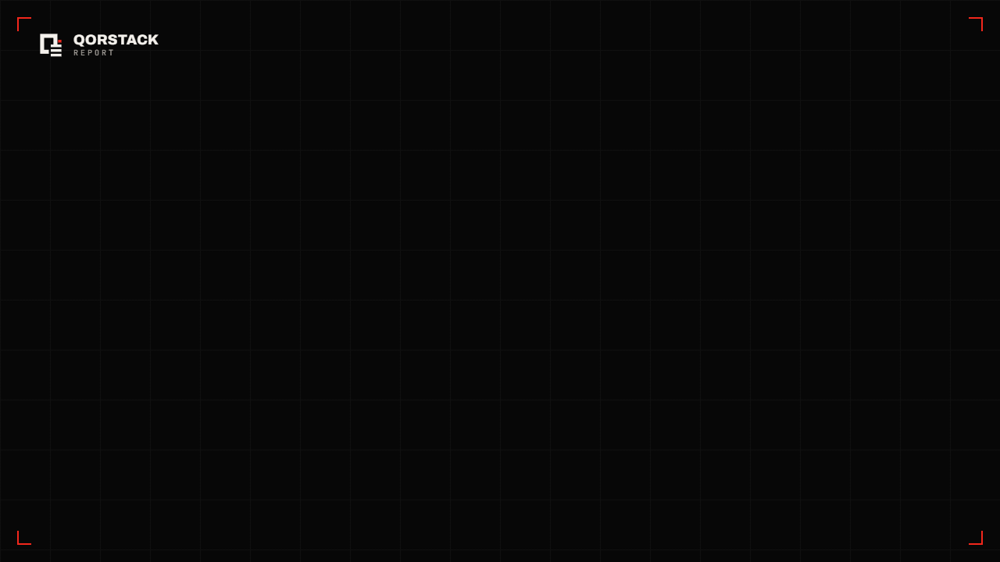
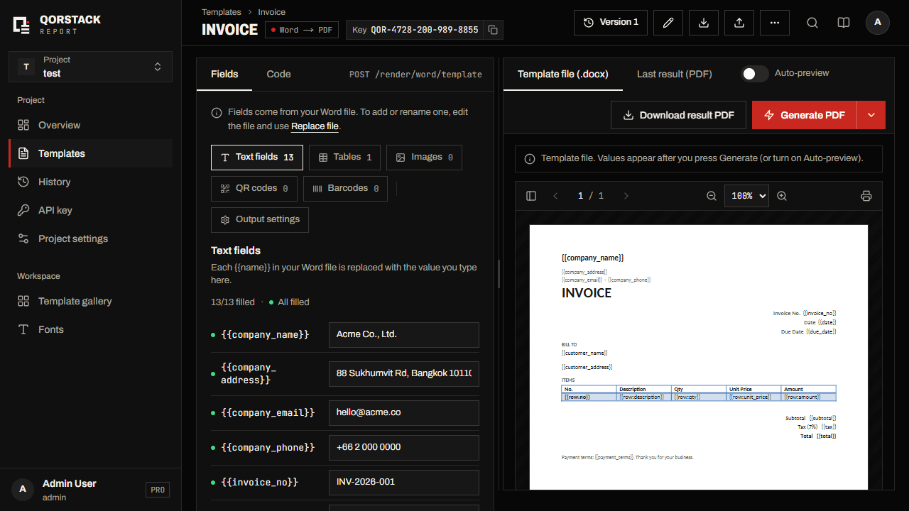

# Qorstack Report

<p align="center">
  
</p>

Generate PDF and Excel reports from DOCX and XLSX templates through a REST API.
Qorstack Report is self-hostable with Docker Compose and runs with PostgreSQL,
S3 storage (RustFS by default, MinIO or any S3), and Gotenberg.

<p align="center">
  
</p>

---

## Quick Start

The self-host setup lives in `selfhost/`. One Docker Compose file runs PostgreSQL, RustFS (S3 storage),
font-syncer, Gotenberg and one `app` container (web UI + API). Only `app` publishes a port (8080).

### Requirements

| Requirement    | Minimum |
| -------------- | ------- |
| Docker         | 24+     |
| Docker Compose | v2      |
| RAM            | 2 GB    |
| Disk           | 5 GB    |

### Run it

```bash
git clone https://github.com/qorstack/qorstack-report.git
cd qorstack-report/selfhost
bash init.sh          # writes .env with random secrets and prints the admin password
docker compose up -d
```

Every setting is documented inline in [`selfhost/.env.example`](selfhost/.env.example).

Open:

| What           | URL                                                    |
| -------------- | ------------------------------------------------------ |
| Web UI         | [http://localhost:8080](http://localhost:8080)         |
| API            | `http://localhost:8080/api` (e.g. `/api/render/word/template`) |
| API reference  | [http://localhost:8080/api/docs](http://localhost:8080/api/docs) |

The web UI and the API ship as **one image** (`qorstack/report`) on **one port** — change it with
`APP_PORT`, and set `PUBLIC_URL` to the address people open.

Sign in as `admin` with the password `init.sh` printed (it is also `ADMIN_PASSWORD`
in `.env`). Check the stack with `bash verify.sh`.

### Storage

Files live in one bucket, `STORAGE_BUCKET` (default `qorstack-report`), created on
start with three folders: `template/` (uploaded templates), `generated-report/`
(generated files; `temp-download/` is deleted after 1 day) and `fonts/` (uploaded
fonts, mirrored to Gotenberg by font-syncer with rclone).

Any S3-compatible server works. RustFS is bundled and starts by default; to use something
else, set `COMPOSE_FILE` in `.env` (the lines are there, commented):

| `.env`                                                         | Storage                                                                 |
| -------------------------------------------------------------- | ----------------------------------------------------------------------- |
| *(nothing)*                                                    | bundled RustFS (Apache-2.0) — default                                   |
| `COMPOSE_FILE=docker-compose.yml:docker-compose.minio.yml`     | bundled MinIO — pinned from quay.io (MinIO left Docker Hub)             |
| `COMPOSE_FILE=docker-compose.yml:docker-compose.external-s3.yml` | external S3 (AWS S3, Cloudflare R2, your own MinIO/RustFS) via `STORAGE_*` |

If storage cannot be reached the backend logs and returns a clear error
("Cannot reach file storage at … — check STORAGE_ENDPOINT…", HTTP 503), and `/health`
reports the `storage` check as unhealthy.

Storage is never exposed to the browser: download links point at the API
(`{PUBLIC_URL}/api/files/{token}`, signed and time-limited), which streams the file.
v1 `MINIO_*` variable names still work as fallbacks for `STORAGE_*`.

### Upgrading to v2

v2.0.0 has three breaking changes. Staying on v1? Keep your v1 compose file and pin `REPORT_API_TAG=1.1.0` /
`REPORT_WEB_TAG=1.1.0` in its `.env` — the last v1 release, which still accepts the old request form.

**1. Storage moved to one bucket (and RustFS is the default).** v1 used three
MinIO buckets (`templates`, `reports`, `fonts`). Copy them once, before starting v2 —
either stay on MinIO or move to RustFS:

```bash
cd selfhost
git pull                              # or download docker-compose.yml + migrate-storage.sh for v2
bash migrate-storage.sh keep-minio    # copy into one bucket on your MinIO   → adds the minio COMPOSE_FILE
# or
bash migrate-storage.sh to-rustfs     # copy from MinIO into RustFS (default, nothing to set)
docker compose pull && docker compose up -d
```

The script uses rclone and copies only (old buckets and the MinIO volume are kept). With
`keep-minio` it adds the minio `COMPOSE_FILE` line to `.env`; with `to-rustfs` it reads the old
MinIO volume through a temporary container (`OLD_MINIO_VOLUME=…` if it is not `<folder>_minio_data`). Your v1 `MINIO_*` values keep
working. If you skip the copy, v2 starts but older templates, history files and fonts
are missing (on MinIO the backend logs a warning pointing here). Custom v1 bucket names?
Run `OLD_TEMPLATE_BUCKET=… OLD_REPORT_BUCKET=… bash migrate-storage.sh <mode>`, then point
saved builder images at the new names:

```sql
UPDATE template_versions
SET sandbox_payload = replace(replace(sandbox_payload::text,
      '"minio:my-templates/', '"minio:templates/'),
      '"minio:my-reports/',   '"minio:reports/')::json
WHERE sandbox_payload IS NOT NULL;
```

After checking templates and fonts in the web app, remove the old buckets (keep-minio)
or the old `minio_data` volume (to-rustfs).

**2. Render requests use keyed arrays only.** The v1 object (dictionary) form was
removed — send `[{ "key": …, "value": … }]`. See [CHANGELOG.md](CHANGELOG.md)
for a before/after example. SDKs: update to the new major version.

**3. One image, one port, API under `/api`.** `qorstack/report-api` + `qorstack/report-web`
(ports 8080 + 3000) became one image, `qorstack/report`, on port 8080: web UI at `/`, API at
`/api` (e.g. `http://localhost:8080/api/render/word/template`). Use the v2
`docker-compose.yml` (service `app`). In `.env`, `API_URL`, `CORS_ORIGINS` (unless other
origins call the API), `FRONTEND_PORT` and `REPORT_API_TAG`/`REPORT_WEB_TAG` are gone;
set `PUBLIC_URL` (and `APP_PORT` if 8080 is taken). API clients: add `/api` to the base
URL — the v2 SDKs and the MCP server append it automatically to v1-style URLs.

See [report.qorstack.com/self-host](https://report.qorstack.com/self-host) for the
full guide: production secrets, access from another machine, external
PostgreSQL / S3 storage, Pro license activation, updating, stopping, and troubleshooting.

---

## For AI Agents

Deploying or integrating Qorstack with an AI agent (Claude, Cursor, etc.)?

- **[AGENTS.md](AGENTS.md)** — deploy, create an API key, the `X-API-Key` render
  flow, when to use Qorstack vs. Gotenberg, and a copy-paste prompt to have your
  AI set it all up.
- **[mcp/](mcp/README.md)** — a Model Context Protocol server exposing list/generate
  tools, so MCP-capable agents drive Qorstack natively instead of hand-writing REST calls.
- **[llms.txt](llms.txt)** — machine-readable summary.

---

## Features

| Feature                                 | Open Source | Pro |
| --------------------------------------- | :---------: | :-: |
| DOCX templates to PDF / DOCX generation |     ✅      | ✅  |
| XLSX templates to XLSX generation       |     ✅      | ✅  |
| Template management                     |     ✅      | ✅  |
| Font management and sync                |     ✅      | ✅  |
| Projects with RBAC                      |     ✅      | ✅  |
| Authentication                          |     ✅      | ✅  |
| API keys per project                    |     ✅      | ✅  |
| Analytics and generation history        |     ✅      | ✅  |
| PDF password protection                 |     ⛔      | ✅  |
| PDF watermarking                        |     ⛔      | ✅  |
| Live Preview auto-render                |     ✅      | ✅  |
| Template version history (10 versions)  |     ⛔      | ✅  |
| Download / export results as ZIP        |     ⛔      | ✅  |
| Async render jobs + webhooks            |     ⛔      | ✅  |
| Project export & import (ZIP)           |     ⛔      | ✅  |

---

## Template Syntax

DOCX and XLSX templates use the same `{{variable}}` syntax.
See the full reference at [report.qorstack.com/docs](https://report.qorstack.com/docs).

---

## Documentation

| Document              | Link                                                                                           |
| --------------------- | ---------------------------------------------------------------------------------------------- |
| API Reference         | [backend/documents/02_API-REFERENCE.md](backend/documents/02_API-REFERENCE.md)                 |
| DOCX Template Guide   | [backend/documents/03_TEMPLATE-GUIDE.md](backend/documents/03_TEMPLATE-GUIDE.md)               |
| Excel Template Engine | [backend/documents/09_EXCEL-TEMPLATE-ENGINE.md](backend/documents/09_EXCEL-TEMPLATE-ENGINE.md) |
| SDK Usage             | [sdk/README.md](sdk/README.md)                                                                 |
| AI Agents & MCP       | [AGENTS.md](AGENTS.md), [mcp/README.md](mcp/README.md)                                         |
| Changelog             | [CHANGELOG.md](CHANGELOG.md)                                                                   |

---

## Tech Stack

| Layer       | Technology                                             |
| ----------- | ------------------------------------------------------ |
| Frontend    | Next.js 16, React 19, TypeScript, Tailwind CSS, HeroUI |
| Backend     | C# .NET 10, ASP.NET Core, Entity Framework Core        |
| Database    | PostgreSQL 16                                          |
| Storage     | S3: RustFS (default), MinIO, AWS S3, R2                |
| DOCX engine | Open XML SDK and custom template processor             |
| XLSX engine | ClosedXML                                              |
| PDF engine  | Gotenberg 8                                            |
| Auth        | JWT and OAuth                                          |

---

## Roadmap

- **Shipped** — REST API; Word → PDF/DOCX, Excel → XLSX; multi-arch images (incl. Apple Silicon); AGENTS.md + MCP server; runnable examples.
- **Now** — template gallery (import ready-made templates); lite single-container mode; clearer template-error messages.
- **Next** — create templates with AI; MCP package on npm; Python & Go SDKs; batch generation API.
- **Exploring** — template marketplace; webhooks.

Want something prioritized? [Open an issue](https://github.com/qorstack/qorstack-report/issues).

---

## Development

For contributors who want to modify the application. Requirements: .NET 10 SDK, Node 20 + pnpm, Docker, `make`.

```bash
git clone https://github.com/qorstack/qorstack-report.git
cd qorstack-report
cp .env.dev.example .env     # one .env for everything — same variable names as selfhost/.env.example
make infra-up                # postgres :5432, RustFS :9000 (console :9001), Gotenberg :3001
make dev                     # backend :5000 (dotnet watch) + web :3000 (next dev) → open http://localhost:3000
```

- The backend reads the root `.env` in Development (real environment variables win) and maps the
  flat names (`DB_*`, `STORAGE_*`, `JWT_KEY`, …) to its configuration, exactly like the compose files.
  `backend/src/Web/appsettings.Development.json` only holds non-secret settings (logging etc.).
- The web dev server needs no env of its own: it proxies `/api/*` to `DEV_BACKEND_URL`
  (default `http://localhost:5000`), so the browser talks to one origin, like production.
- Using your own Postgres / S3 / Gotenberg? Point `DB_*`, `STORAGE_*`, `GOTENBERG_URL` in `.env` at them
  and skip `make infra-up`.
- `make backend` / `make frontend` run one side only; `make infra-down` stops the containers.
- `make prod-local` builds the real image and runs the full stack on http://localhost:8080 with the same
  `.env` — a production-like check before a release (`make prod-local-down` to stop).

In production the frontend is a static export (`pnpm build` → `frontend/out/`) that the backend serves
from `wwwroot`; the root `Dockerfile` builds both into the single `qorstack/report` image.

---

## License

Qorstack Report is **open core**:

- All code in this repository is **MIT licensed** — see [LICENSE](LICENSE). You can
  self-host, modify, and use it commercially, for free.
- The optional **Pro** features ship as a separate closed-source module, activated
  by a paid `license.json` and governed by the
  [Commercial License](LICENSE-COMMERCIAL.md). Without a Pro license those features
  are simply disabled — the MIT core remains fully functional on its own.

See [LICENSING.md](LICENSING.md) for the full breakdown of what is free vs. Pro.
